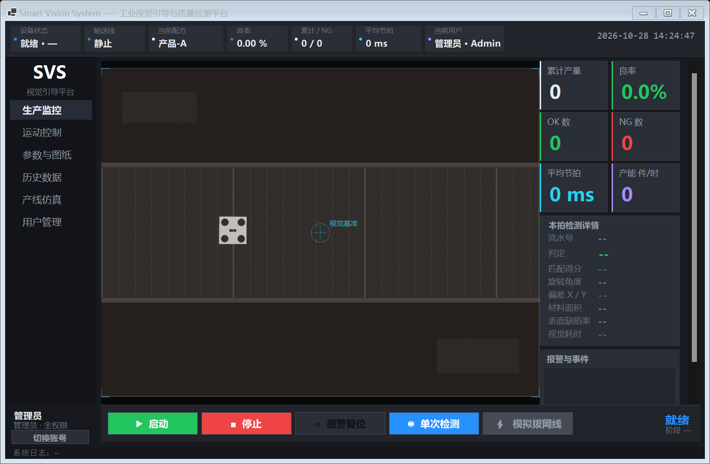
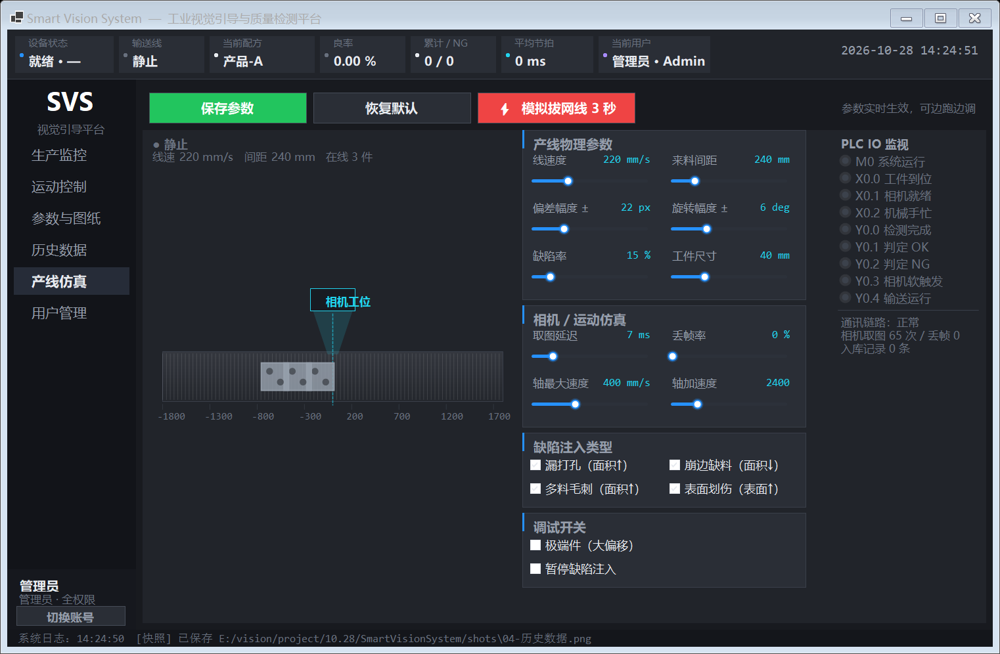
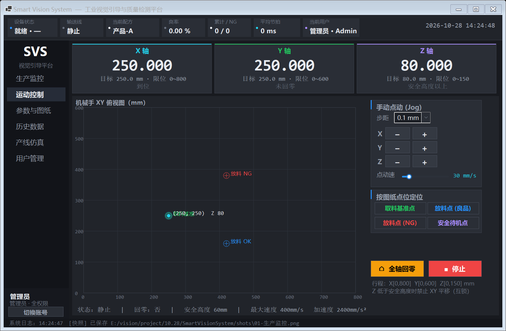
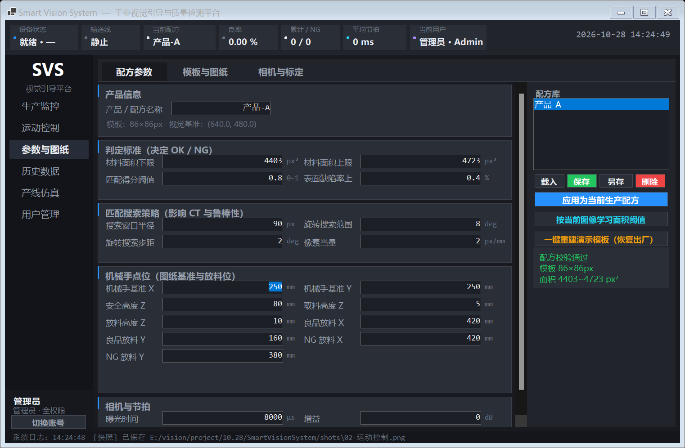
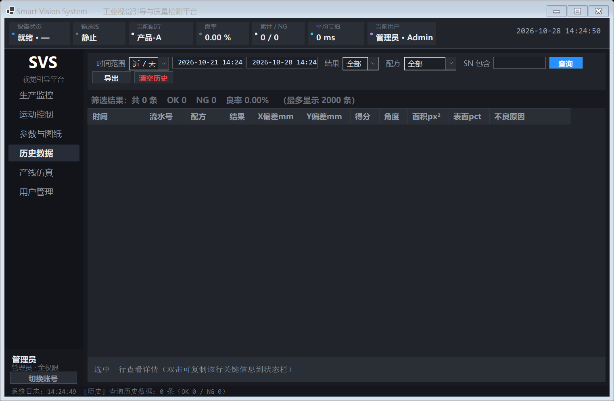
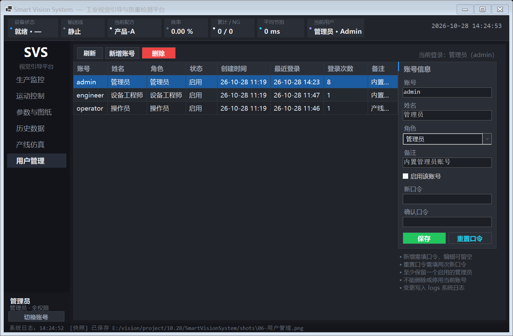
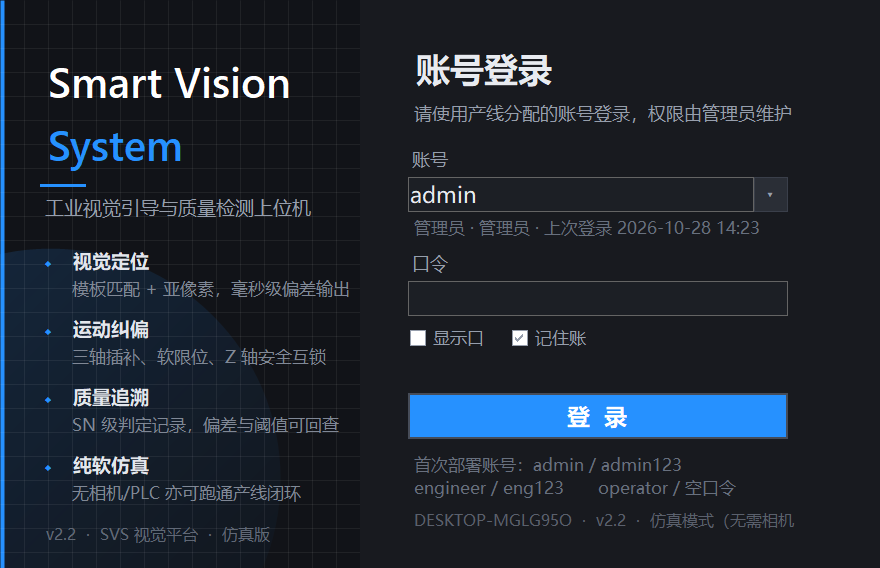

# Smart Vision System · 工业视觉引导与质量检测上位机

> 视觉拍照 → 模板匹配 → 偏差计算 → 机械手纠偏 → 良率判定 → SN 级追溯，一条完整闭环。
> **全链路纯软件仿真**：没有相机、没有运动控制卡、没有 PLC，一台笔记本也能把整条产线跑起来。


-003B57?logo=sqlite&logoColor=white)




---

## 这是什么

面向离散制造（3C 电子 / 汽车零部件 / 半导体）的**视觉引导 + 质检**上位机。它解决的是产线上最典型的三个问题：

| 现场痛点 | 本项目的答案 |
|---|---|
| 来料位置不固定，固定坐标抓取必撞机 | 模板匹配算出 X/Y 偏移与旋转角，补偿给运动卡再抓 |
| 人眼质检疲劳、漏检、判定靠主观 | 面积 / 匹配得分 / 表面缺陷率数字化判定，标准可复现 |
| 出了问题无法追溯 | 每一拍落库：SN、偏差(mm/px)、得分、面积、CT、不良原因 |

而它最特别的地方是**可以在没有任何硬件的电脑上完整演示与验收**：虚拟产线按 mm 推进、虚拟相机实时渲染出带噪声与曝光的图像、虚拟运动卡按梯形速度曲线走位、虚拟 PLC 完成 IO 握手。三者共享一条可切断的"网络链路"，拔掉网线就真的会报警停线、恢复后自动重连续跑。



---

## 功能

| 模块 | 能力 |
|---|---|
| **生产监控** | 实时画面 + 检测叠加（模板框、偏差矢量、基准十字）、六宫格看板（产量/良率/OK/NG/节拍/UPH）、本拍详情、报警流、大按钮启动/停止 |
| **运动控制** | 三轴点动（可调步距/速度）、回零、软限位、Z 轴安全互锁、按配方点位一键定位、XY 平面位置图 |
| **参数与图纸** | 配方增删改、加载图纸、鼠标框选建立模板（Zoom 坐标已换算）、判定阈值（面积上下限/得分/表面缺陷率）、相机曝光增益、像素当量标定 |
| **历史数据** | 时间范围/结果/配方/SN 组合筛选、明细回看、CSV 导出、汇总统计 |
| **产线仿真** | 线速、来料间距、偏差幅度、旋转幅度、缺陷率、工件尺寸、取图延迟、丢帧率、四类缺陷开关、拔网线演练、PLC IO 监视 |
| **用户管理** | 账号增删改、启用停用、重置口令；PBKDF2-SHA256 存储；分级权限；登录失败锁定 |

### 权限分级

| 能力 | 操作员 Operator | 工程师 Engineer | 管理员 Admin |
|---|:--:|:--:|:--:|
| 生产监控 / 历史查询 | ✓ | ✓ | ✓ |
| 参数与配方 / 运动点动 / 产线仿真 | ✗ | ✓ | ✓ |
| 用户管理 / 清空数据 | ✗ | ✗ | ✓ |

切换账号后导航会按新角色**重建并销毁**越权页面，`UserManageView` 构造时还有第二道闸门（非管理员连账号数据都不加载）。

---

## 架构

```
SmartVisionSystem/
├── Infrastructure/   路径约定 · 异步滚动日志 · 主题控件工厂 · 用户库/权限
├── Simulation/       虚拟产线(间歇定位) · 虚拟场景渲染(合成相机画面)
├── Hardware/         ICamera / IMotionController / IPlc 接口 + Sim* 仿真实现 + NetworkLink(断线重连)
├── Core/             VisionEngine(检测) · Recipe/RecipeStore · StationController(状态机) · DeviceHub(单例总线) · SelfTest
├── UI/               登录 / 主壳 / 生产监控 / 运动 / 参数 / 历史 / 仿真 / 用户管理 + UiKit
├── DatabaseManager   检测记录持久化（WAL + 异步写入 + 条件查询 + CSV 导出）
└── Program.cs        正常启动 / --auto 跳过登录 / --selftest 无头自检 / --shot 界面快照
```

**核心约束：所有页面只通过 `DeviceHub.I` 取设备**，不允许各自 `new` 硬件对象——上位机最常见的技术债就是"每个 Tab 一套设备实例"，导致界面之间状态互不相通。

### 一次生产拍的闭环

```
PLC 触发(工件到位,线停)
   ↓
相机取图 (SimCamera 渲染带曝光/噪声/丢帧的画面)
   ↓
VisionEngine: 多角度模板匹配 → 抛物线亚像素 → 外轮廓减内孔算材料面积 → 内区暗点算表面缺陷
   ↓
偏差 (Δx, Δy, θ) → 补偿量下发运动卡 (SimMotionController 梯形速度曲线)
   ↓
机械手取放 (Z 先抬到安全高度，互锁校验)
   ↓
OK/NG 判定 → 写库(SQLite) → 结果回传 PLC → 放行/剔除
```

工位状态机跑在独立线程，UI 只订阅事件并用 `BeginInvoke` 回主线程，算法不会卡界面。

---

## 快速开始

**环境**：Windows 10/11 + [.NET 10 SDK](https://dotnet.microsoft.com/download)。不需要相机、不需要 PLC、不需要数据库服务。

```bash
git clone https://github.com/Yixi233-mo/SmartVisionSystem.git
cd SmartVisionSystem
dotnet run
```

首次启动会自动建库、生成演示配方与模板，直接就能点【启动】跑生产。

### 默认账号

| 账号 | 口令 | 角色 |
|---|---|---|
| `operator` | *(空)* | 操作员 |
| `engineer` | `eng123` | 设备工程师 |
| `admin` | `admin123` | 管理员 |

> 首次部署后请立刻在【用户管理】里改口令。口令以 PBKDF2-SHA256（16B 盐 / 12 万次迭代）存储，无法反推。

### 命令行参数

| 命令 | 用途 |
|---|---|
| `dotnet run` | 正常启动（走登录页） |
| `dotnet run -- --auto` | 跳过登录直接进入（现场调机） |
| `dotnet run --no-build -- --selftest` | 无头自检，报告写 `logs/selftest.log` |
| `dotnet run --no-build -- --shot <目录>` | 逐页生成界面快照（布局回归） |

### 五分钟验收路线

1. 用 `admin` 登录 → 进【产线仿真】，把线速拉到 500 mm/s、缺陷率拉到 40%，回【生产监控】点【启动】；
2. 看良率与 CT 实时变化，NG 件会显示判定原因；
3. 点【⚡ 模拟拔网线】→ 全线报警停线 → 3 秒后自动重连续跑；
4. 进【历史数据】按 SN 回溯刚才那一拍的全部参数。

---

## 自检基线

`dotnet run --no-build -- --selftest` 的实测结果（完整报告见 [`docs/selftest-report.txt`](docs/selftest-report.txt)）：

| 指标 | 实测 | 要求 |
|---|---|---|
| 缺陷检出率 Recall | **100.00%**（240 件，四类缺陷各 100%） | ≥ 95% |
| 良品误判 FP | **0** | ≤ 3 |
| 纯平移定位误差 | **0.0002 mm**（≈0.000 px） | < 0.05 mm |
| 含旋转定位误差 | 平均 0.0321 / 最大 0.1041 mm | < 0.15 mm |
| 视觉 CT | P50 **11.7 ms** / P95 **13.5 ms** | < 50 ms |
| 标称件面积重复性 | 极差 **0 px²** | — |
| 数据库读写一致性 | 50 条写入 → 汇总/查询完全一致 | 必须一致 |
| 全链路联调 | 连续 6 拍闭环、无报警、落库 6 条 | 必须通过 |

自检不是"跑通就算"，它分 8 段：标称件重复性 → 定位精度分解（纯平移 vs 含旋转）→ 随机来料压力测试（混淆矩阵）→ CT 分布 → 持久化 → 用户权限 → 运动仿真 → 全链路联调。

---

## 几个值得说的工程决策

**1. 模板余量只留 3px**
余量越大，混入模板的背景像素越多；工件旋转时背景不跟着转，相关峰会偏移。实测 8px 余量会带来 0.17 mm 的纠偏误差，3px 降到 0.0002 mm。

**2. 测面积时绝不做开运算**
3×3 开运算会把 1~2px 宽的划伤整条擦掉——"表面划伤"这类缺陷会永远检不出。噪点交给 Otsu + 面积阈值。

**3. 孔洞阈值 80px²**
小于该值的轮廓视为划伤/纹理，既不计入材料缺失，也不从表面分析掩膜里挖掉，否则划伤会被当成孔"挖空"。

**4. 虚拟工件按亚像素落位**
整数像素落位会引入 ±0.5px（=0.25mm）的量化误差，足以掩盖算法真实精度。改用仿射矩阵的亚像素平移后，误差才降到 0.0002mm 量级。

**5. UI 里没有一处写死像素高度**
WinForms 在 125% 缩放下会把写死 `Height = 12` 的标题切掉一半。全部改用 `Theme.LineHeight(font)` / `KpiCard.PreferredHeight()` 推导，表格列宽取 `max(业务宽度, 表头实测宽度)`。

**6. 原生控件必须自绘或发消息**
只读 `TextBox` 会忽略 `BackColor`（要发 `EM_SETBKGNDCOLOR`）、`ComboBox` 的按钮区由系统绘制（要 `OwnerDrawFixed` + 处理 `WM_PAINT/WM_PRINT`）、`TrackBar`/滚动条不跟随主题。这些都做了替代实现，界面才有完整的深色一致性。

---

## 更多界面

<details>
<summary>展开看其余页面（运动控制 / 参数与配方 / 历史数据 / 用户管理 / 登录）</summary>

**运动控制**


**参数与配方**


**历史数据**


**用户管理**


**登录**


</details>

---

## Roadmap

- [ ] **UI 迁移 WPF / Avalonia + MVVM**：设备层已完全接口化（`ICamera` / `IMotionController` / `IPlc`），换 UI 时业务层零改动
- [ ] **算法升级**：YOLOv8 + ONNX Runtime 处理光照变化与大幅旋转；形状匹配（Shape-Based Matching）替代灰度相关
- [ ] 多工位并行与配方版本管理
- [ ] MES / 上位系统对接（HTTP / OPC UA）
- [ ] 中英日多语言

> 为什么现在还是 WinForms：现场验证之前换 UI 框架是在未验证的逻辑上做二次赌注。先把仿真闭环与判定标准跑扎实，再迁移。

## 环境与依赖

.NET 10 · WinForms · OpenCvSharp4 4.13 · Microsoft.Data.Sqlite 10。日志、主题、权限、图像映射均为自研，未引入 NLog/Serilog 等第三方日志包——现场部署时少一个依赖就少一个坑。

运行期数据全部落在可执行文件旁：`data/production.db`（生产记录）、`data/users.db`（账号）、`data/recipes/*.json + *.png`（配方与模板）、`logs/yyyy-MM-dd.log`（滚动日志）。

## License

[MIT](LICENSE) © 2026 屹兮
